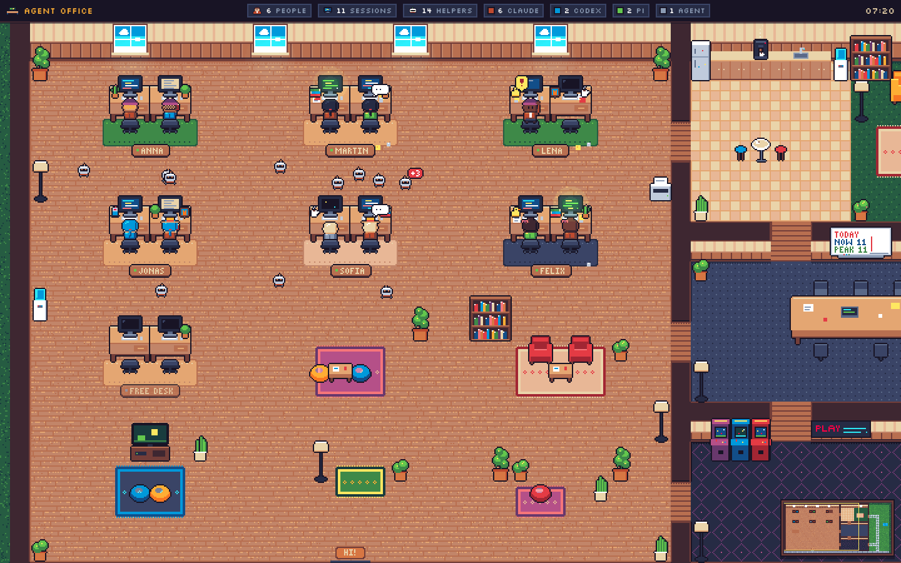
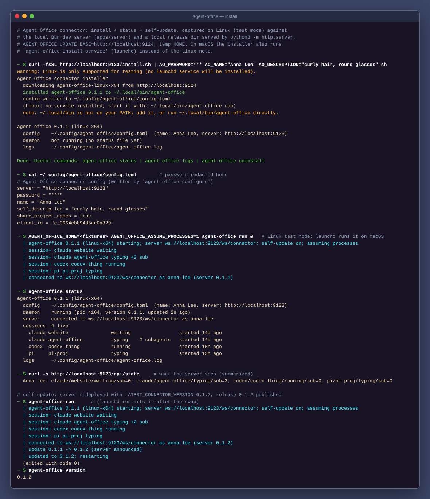
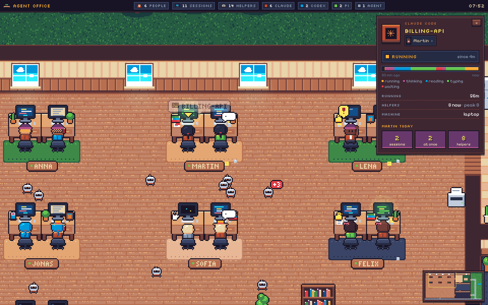
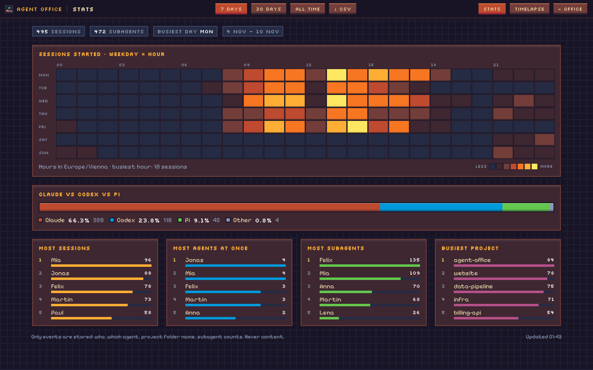
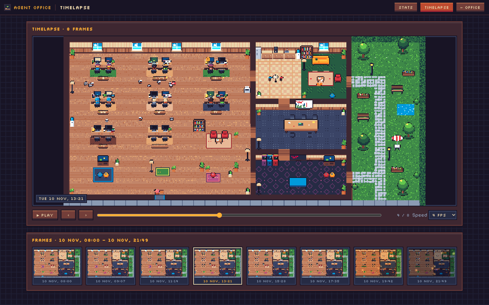

# Agent Office

A cozy pixel-art office that shows, live, who on the team is working with which coding agent.
Every teammate is a character; every running Claude Code, Codex or Pi session is another desk
with them at it, typing, reading, thinking, or raising a hand when the agent waits for input.
Subagents scurry around as little bots.



A small connector on each Mac watches local agent sessions (read-only, from the agents' own
transcript files) and reports *status only* to a Cloudflare Worker, which renders the office
for everyone.

## Join the office (teammates)

```sh
curl -fsSL https://github.com/MrGatzi/agent-camp/releases/latest/download/install.sh | sh
```

It asks five things: the **server URL** and **shared password** (whoever runs the office gives
you both), your **name**, an optional **description** of yourself ("curly hair, round
glasses") that shapes your avatar, and a **name for this machine** (defaults to its short
hostname). Done: the connector runs in the background (launchd) and starts at login.
Re-run the same line any time to change answers. It updates itself.
`curl -fsSL https://<your-server>/install.sh | sh` does the same with the URL already filled in.

```sh
agent-office status      # connected? which sessions does it see?
agent-office logs        # follow the log
agent-office uninstall   # stop and remove everything
```



### Two machines, one you

Run the connector on every machine you code on (laptop, remote devbox, ...) and give it the
**same name** everywhere: the office matches people by name (case and extra spaces don't
matter), so you stay one character with one look, and the sessions from all your machines
sit side by side in your pod. The description only needs to be set on one machine; a machine
without one never changes your look, and the last description you set wins. The machine
name (`agent-office configure --machine-name devbox`, or `AO_MACHINE=` for the installer)
shows up on the agent card so you can tell the sessions apart.

### How do I look?

The server picks your look. With AI off it comes from a hash of your name; with AI on it is
chosen from your one-line description, but only from a fixed catalog of hair, glasses,
clothes and props, so everyone stays in the same pixel style. Your jacket colour shows
which agent a session runs (Claude, Codex, Pi). Every extra session is a sibling of you
with tiny variations, and your pod has one desk per running session (at least 2, up to 6).

### Privacy

Sent: agent kind (Claude/Codex/Pi), a salted hash of the session id, the project **folder
name** (turn off with `share_project_names = false` in `~/.config/agent-office/config.toml`),
an activity verb (typing/reading/thinking/running/waiting/idle), the subagent count, when the
session started, the connector version, and the **machine name** you chose (`machine_name`,
defaults to the short hostname, e.g. `martins-mbp`; set it to anything you like).

Never sent: prompts, responses, code, file contents or paths, commands, tool output, or
anything else from a transcript. A unit test feeds a transcript containing a fake secret and
checks it never appears in any outgoing message. History keeps only events (who, which agent,
project folder name, subagent counts), never content.

## Watching

| URL                  | What                                                                  |
| -------------------- | --------------------------------------------------------------------- |
| `/`                  | The office. Drag to pan, wheel/pinch to zoom. Click a character for its agent card, a nameplate for the person. |
| `/?kiosk=1`          | Wall/iPad mode: no chrome, bigger text, auto camera tour. Add it to the iPad home screen; it also records the timelapse (`&recorder=1`). |
| `/stats`             | Weekday × hour heatmap, leaderboards, Claude vs Codex vs Pi, CSV export. |
| `/timelapse`         | Snapshots of the office every 15 minutes, with a play button.          |

Other handy params: `?zoom=fit`, `?hour=22` (preview night), `?nohud=1`, `?demo=busy` (no
server needed). If the server sets `VIEWER_KEY`, add `?key=…`.



| Stats | Timelapse |
| ----- | --------- |
|  |  |

## Try it locally in Chrome

```sh
bun install && bun run dev            # then open http://localhost:5173
bun run sim -- --scenario busy        # in a second terminal: 6 fake teammates walk in
```

No server at all: `bun run --filter @agent-office/web dev` and open
http://localhost:5173/?demo=busy.

## Developing

Bun monorepo: `packages/protocol` (zod wire schemas), `apps/connector` (Bun-compiled CLI),
`apps/server` (Worker + Durable Object), `apps/web` (Vite + PixiJS), `tools/sim`
(fake teammates over the real protocol), `tools/screenshots`.

```sh
bun install
bun run dev                           # wrangler dev :8787 + vite :5173 (hot reload), open :5173
bun run sim -- --scenario busy        # 6 people walk in (also: one, empty, join, stress, live)
bun run sim -- --backfill-week        # a fake week of history for /stats
bun run sim -- --snapshots 12         # test frames for /timelapse
```

The dev password is `devpass`. Run a connector against it with
`bun apps/connector/src/main.ts run --server http://localhost:8787 --password devpass --name You`.

```sh
bun run lint && bun run typecheck && bun test   # what CI runs first
bun run test:e2e      # real server + real connector on fixtures + viewer socket
bun run screenshots   # builds web, real server + simulator, Playwright -> screenshots/
```

`bun run screenshots` needs Chromium for Playwright (`bunx playwright install chromium`
once). It writes laptop (1440×900) and iPad (1180×820) shots plus `03-busy.gif`.

## Deploy / setup

You need a (free) Cloudflare account. GitHub builds the connector releases with its own
built-in token and Cloudflare builds the server itself, so no Cloudflare keys ever live in
GitHub.

**1. Connect the repo (once).** Cloudflare dashboard → **Workers & Pages** → **Create** →
**Import a repository** → pick `MrGatzi/agent-camp`, then set:

| Field            | Value |
| ---------------- | ----- |
| Project name     | `agent-office` (must match `name` in `apps/server/wrangler.toml`) |
| Root directory   | leave empty (repo root) |
| Build command    | `bun install --frozen-lockfile && bun run --filter @agent-office/web build` |
| Deploy command   | `cd apps/server && npx wrangler deploy` |
| Build variable   | `BUN_VERSION` = `1.4.4` (same Bun as the lockfile) |

From then on every push to `main` deploys the office (Cloudflare) and publishes new connector
binaries (GitHub Release `v0.1.N`). Connectors update themselves: the server looks up the newest
GitHub release when they connect, and each connector also checks GitHub every 5 minutes. If the
build ever complains about Bun, use the npm-only build command
`npx -y bun@1.4.4 install --frozen-lockfile && npx -y bun@1.4.4 run --filter @agent-office/web build`.

**2. Set the connector password (once).** Dashboard → your `agent-office` Worker →
**Settings** → **Variables and Secrets** → **Add** → type *Secret*, name `CONNECTOR_PASSWORD`,
any value. (Or from `apps/server`: `npx wrangler secret put CONNECTOR_PASSWORD`.)

**3. Invite the team.** Share the Worker URL (`https://agent-office.<you>.workers.dev`) and the
password. Teammates run
`curl -fsSL https://github.com/MrGatzi/agent-camp/releases/latest/download/install.sh | sh`.
Open `https://<worker-url>/?kiosk=1&recorder=1` on the office iPad.

**4. Optional extras** (same Variables and Secrets page): `VIEWER_KEY` (secret; watching then
needs `?key=…`), and AI avatars from descriptions with `GENUI_PROVIDER=anthropic` +
secret `ANTHROPIC_API_KEY`, or `GENUI_PROVIDER=jev` + secret `AI_GATEWAY_API_KEY` (Vercel AI
Gateway); `GENUI_PROVIDER` is a plain *Text* variable. Everything works without them (AI off).
Deploys keep what you add there; only the variables listed in `apps/server/wrangler.toml` are
reset to its values.

**Other ways to deploy**

- *From your laptop, no token:* `npx wrangler login` (opens the browser), then
  `bun install && bun run deploy`. Good for a first try; connector releases still come from
  GitHub on every push to `main`.
- *From GitHub Actions:* add repo secrets `CLOUDFLARE_API_TOKEN` and `CLOUDFLARE_ACCOUNT_ID`;
  the optional `deploy` job in `release.yml` then deploys after each release (it skips while
  they are missing). Use this *or* Workers Builds, not both.

## More

- [PLAN.md](PLAN.md): the original brief and scope.
- [DECISIONS.md](DECISIONS.md): every implementer-decides choice, with one line of reasoning.
